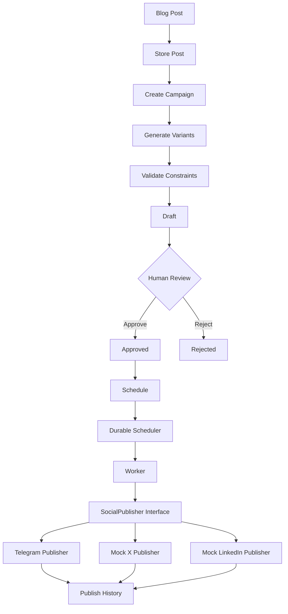

# Social Media Studio

A production-quality backend system for converting blog posts into platform-specific social media content, with human review, durable scheduling, and reliable publishing through a clean adapter architecture.

## Problem Being Solved

Content creators often need to publish the same content across multiple social media platforms, each with different constraints (character limits, hashtag counts, tone). Manual adaptation is time-consuming and error-prone. Social Media Studio automates this process while maintaining human oversight and ensuring reliable, idempotent publishing.

## Key Features

- **Blog Post Ingestion**: Store blog posts as the single source of truth
- **Platform-Specific Variants**: Generate optimized content for Telegram, X, and LinkedIn
- **Constraint Validation**: Enforce platform-specific rules (length, hashtags, etc.)
- **Human Review Workflow**: Draft → Approve/Reject → Schedule → Publish
- **Durable Scheduling**: BullMQ + Redis for reliable job scheduling
- **Idempotent Publishing**: Guaranteed no duplicate publications
- **Adapter Architecture**: Clean interface-based publisher abstraction
- **Real Telegram Integration**: Actual Telegram Bot API publishing
- **Mock Adapters**: Database-based simulation for X and LinkedIn
- **Publish History**: Complete audit trail of all publish attempts
- **Worker Recovery**: Survives restarts without creating duplicates

## Architecture

### High-Level Architecture



### Component Architecture

```
┌─────────────────────────────────────────────────────────────┐
│                        HTTP Layer                            │
│  Controllers → Routes → Validators                          │
└─────────────────────────────────────────────────────────────┘
                              ↓
┌─────────────────────────────────────────────────────────────┐
│                      Business Logic                          │
│  Services → Repositories → Scheduler                         │
└─────────────────────────────────────────────────────────────┘
                              ↓
┌─────────────────────────────────────────────────────────────┐
│                        Adapters                              │
│  SocialPublisher (Interface)                                 │
│  ├── TelegramPublisher (Real)                               │
│  ├── MockXPublisher (Mock)                                  │
│  └── MockLinkedInPublisher (Mock)                           │
└─────────────────────────────────────────────────────────────┘
                              ↓
┌─────────────────────────────────────────────────────────────┐
│                      Infrastructure                          │
│  PostgreSQL (via Prisma) + Redis (via BullMQ)                │
└─────────────────────────────────────────────────────────────┘
```

## Technology Stack

- **Runtime**: Node.js with TypeScript
- **Web Framework**: Express.js
- **Database**: PostgreSQL with Prisma ORM
- **Queue/Cache**: Redis with BullMQ
- **Validation**: Zod
- **Testing**: Vitest
- **Containerization**: Docker Compose (PostgreSQL + Redis)
- **Configuration**: dotenv
- **Encryption**: native Node.js crypto (AES-GCM)

## Database Design

### Entity Relationships

```
BlogPost (1) ──── (1) Campaign (1) ──── (*) SocialVariant (1) ──── (*) PublishAttempt
                                                        │
                                                        └─── (*) MockPost (for mock adapters)
```

### Key Models

**BlogPost**
- Stores the original blog post content
- Single source of truth for all variants

**Campaign**
- Groups variants for a single blog post
- Tracks campaign lifecycle

**SocialVariant**
- Platform-specific content
- Status: draft, approved, rejected, scheduled, publishing, published, failed
- Scheduled timestamp for delayed publishing

**PublishAttempt**
- Records every publish attempt
- Includes idempotency key for duplicate prevention
- Tracks success/failure and external post IDs

**MockPost**
- Records mock publications for X and LinkedIn
- Enables inspection of simulated publishes

### Database Constraints

- Unique constraint on (variantId, idempotencyKey) for idempotency
- Foreign key constraints on all relationships
- Unique constraint on (campaignId, platform) to prevent duplicate platforms per campaign

## Adapter Architecture

### SocialPublisher Interface

```typescript
interface SocialPublisher {
  publish(input: PublishInput): Promise<PublishResult>;
}

interface PublishInput {
  content: string;
  platform: Platform;
  idempotencyKey: string;
}

interface PublishResult {
  success: boolean;
  externalPostId?: string;
  error?: string;
}
```

### Adapter Selection

Adapter selection is configuration-driven via environment variables:

```bash
PUBLISHER_TELEGRAM=telegram
PUBLISHER_X=mock_x
PUBLISHER_LINKEDIN=mock_linkedin
```

This allows switching between real and mock adapters without code changes.

### Available Adapters

1. **TelegramPublisher**: Real Telegram Bot API integration
2. **MockXPublisher**: Database-based simulation for X/Twitter
3. **MockLinkedInPublisher**: Database-based simulation for LinkedIn

## Idempotency Strategy

### Idempotency Key Generation

```typescript
idempotencyKey = `${variantId}_${scheduledFor.toISOString()}`
```

This ensures:
- Same variant + same scheduled time = same key
- Different scheduled times = different keys (allows rescheduling)
- Deterministic and reproducible

### Duplicate Prevention

1. **Database-level**: Unique constraint on (variantId, idempotencyKey)
2. **Application-level**: Worker checks existing successful attempts before publishing
3. **Queue-level**: BullMQ job deduplication using job IDs

## Scheduling Strategy

### BullMQ Implementation

- **Queue**: `publish-queue`
- **Job Data**: `{ variantId, scheduledFor }`
- **Job Options**: Delay based on scheduled time, 3 retry attempts with exponential backoff
- **Job Deduplication**: `variant-${variantId}` as job ID

### Worker Logic

1. Poll for due jobs from Redis-backed queue
2. Find variant by ID
3. Check if already published (idempotency check)
4. Create PublishAttempt record (status: started)
5. Get appropriate publisher via factory
6. Call publisher.publish()
7. Update PublishAttempt status (success/failed)
8. Update Variant status (published/failed)
9. Handle retries with exponential backoff

### Crash Recovery

On worker restart:
1. BullMQ queue preserves scheduled jobs (Redis-backed)
2. Worker checks for in-progress PublishAttempts
3. Completes or retries based on attempt status
4. Unique constraint prevents duplicate successful publications

## Review Workflow

### Status Transitions

```
draft → approved → scheduled → publishing → published
          ↓
        rejected
```

### Business Rules

- Only approved variants can be scheduled
- Draft variants can be edited
- After editing, must re-validate constraints
- Rejected variants cannot be scheduled
- Scheduled variants cannot be edited
- Publishing status is set by worker only

## Security Approach

### Environment Variables

All secrets via environment variables:
- `TELEGRAM_BOT_TOKEN`: Telegram bot authentication
- `TELEGRAM_CHAT_ID`: Target chat for messages
- `ENCRYPTION_KEY`: For database credential encryption (if needed)

### Secret Protection

- `.env` is in `.gitignore`
- `.env.example` contains only placeholders
- Secrets are never logged
- No hardcoded credentials in code

### Encryption at Rest

If storing platform credentials in database:
- Algorithm: AES-GCM
- Key: From ENCRYPTION_KEY environment variable
- IV/Nonce: Random per encryption, stored with ciphertext
- Never store plaintext credentials

## API Endpoints

### Posts
- `POST /api/posts` - Ingest a blog post
  ```json
  {
    "title": "Example Blog Post",
    "body": "The complete blog content...",
    "url": "https://example.com/article"
  }
  ```
- `GET /api/posts/:id` - Retrieve a blog post

### Campaigns
- `POST /api/campaigns` - Create a campaign from a post
  ```json
  {
    "postId": "uuid"
  }
  ```
- `GET /api/campaigns/:id` - Retrieve a campaign with variants
- `GET /api/campaigns/:id/history` - Get publish history for all variants

### Variants
- `GET /api/variants/:id` - Retrieve a variant
- `PATCH /api/variants/:id` - Edit a draft variant
  ```json
  {
    "content": "Updated content"
  }
  ```
- `POST /api/variants/:id/approve` - Approve a variant
- `POST /api/variants/:id/reject` - Reject a variant
- `POST /api/variants/:id/schedule` - Schedule an approved variant
  ```json
  {
    "scheduledFor": "2024-01-01T12:00:00Z"
  }
  ```
- `GET /api/variants/:id/history` - Get publish history for a variant

### Health
- `GET /api/health` - Health check

## Platform Constraint Profiles

### X (Twitter)
- maxLength: 280 characters
- maxHashtags: 3
- tone: concise, punchy

### LinkedIn
- maxLength: 3000 characters
- maxHashtags: 10
- tone: professional, informative

### Telegram
- maxLength: 4096 characters
- maxHashtags: 5
- tone: clear, readable

## Setup Instructions

### Prerequisites

- Node.js 18+
- Git

### Option 1: Local Development (PostgreSQL + Redis via Docker)

For local development with durable scheduling:

1. Clone the Repository
```bash
git clone <repository-url>
cd flyrank-capstone-social-studio
```

2. Install Dependencies
```bash
npm install
```

3. Start Infrastructure
```bash
docker-compose up -d
```

This starts PostgreSQL and Redis containers.

4. Configure Environment
```bash
cp .env.example .env
```

Edit `.env` with your values:
- Set `DATABASE_URL` to PostgreSQL connection string
- Set `REDIS_URL` to Redis connection string
- Add `TELEGRAM_BOT_TOKEN` and `TELEGRAM_CHAT_ID` for real Telegram publishing
- Set `ENCRYPTION_KEY` (32-byte random string)
- Configure publisher types (e.g., `PUBLISHER_TELEGRAM=mock_x` for testing)

5. Generate Prisma Client
```bash
npm run db:generate
```

6. Run Database Migrations
```bash
npm run db:migrate
```

7. Seed Database (Optional)
```bash
npm run db:seed
```

8. Start the API Server
```bash
npm run dev
```

Server runs on http://localhost:3000

9. Start the Worker (Separate Terminal)
```bash
npm run worker
```


## Test Instructions

### Run All Tests

```bash
npm test
```

### Run Tests with Coverage

```bash
npm run test:coverage
```

## Example Workflow

### 1. Ingest a Blog Post

```bash
curl -X POST http://localhost:3000/api/posts \
  -H "Content-Type: application/json" \
  -d '{
    "title": "The Future of Backend Development",
    "body": "Backend development is evolving rapidly...",
    "url": "https://example.com/article"
  }'
```

### 2. Create a Campaign

```bash
curl -X POST http://localhost:3000/api/campaigns \
  -H "Content-Type: application/json" \
  -d '{
    "postId": "<post-id-from-step-1>"
  }'
```

This generates variants for Telegram, X, and LinkedIn.

### 3. Review and Approve a Variant

```bash
curl -X POST http://localhost:3000/api/variants/<variant-id>/approve
```

### 4. Schedule the Variant

```bash
curl -X POST http://localhost:3000/api/variants/<variant-id>/schedule \
  -H "Content-Type: application/json" \
  -d '{
    "scheduledFor": "2024-01-01T12:00:00Z"
  }'
```

### 5. Monitor Publish History

```bash
curl http://localhost:3000/api/variants/<variant-id>/history
```

## Known Limitations

- Real X/Twitter and LinkedIn integrations are not implemented (mock only)
- Telegram integration requires valid bot token and chat ID
- No web UI (API-only)
- No real-time notifications
- No bulk operations

## Future Improvements

- Add web UI for variant review
- Implement real X/Twitter API integration
- Implement real LinkedIn API integration
- Add analytics dashboard
- Implement webhook notifications
- Add support for Instagram
- Implement A/B testing for variants
- Add campaign templates
- Implement multi-reviewer approval workflows
- Add AI-powered variant generation with external APIs

## License

MIT
